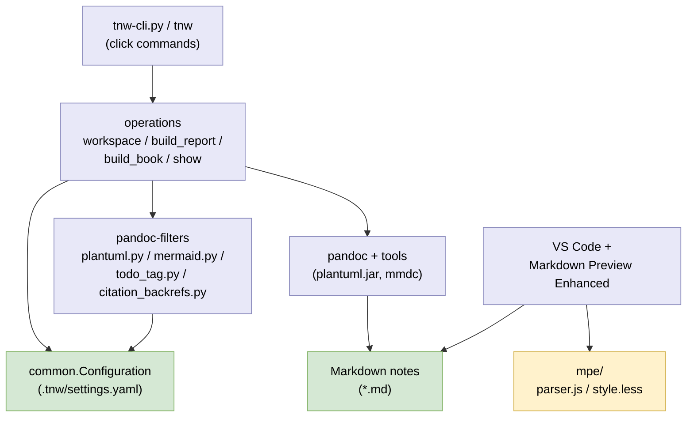
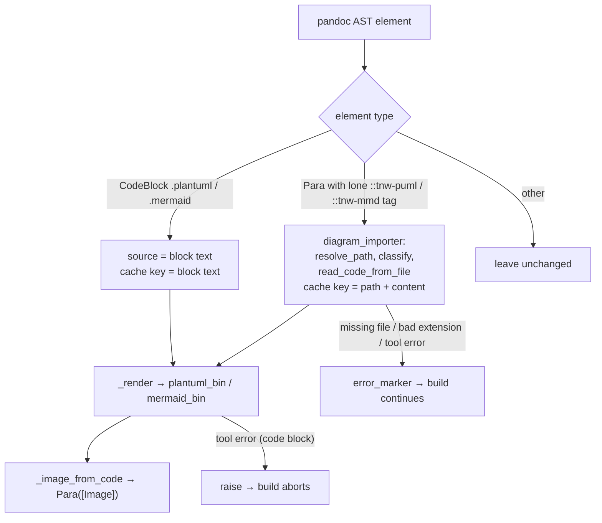
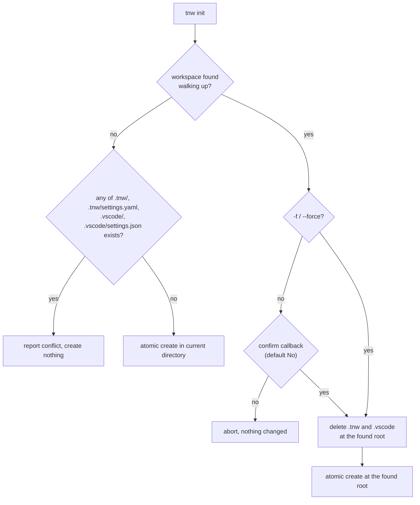
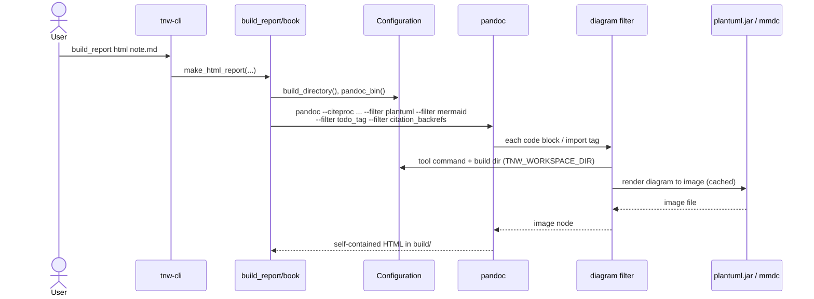
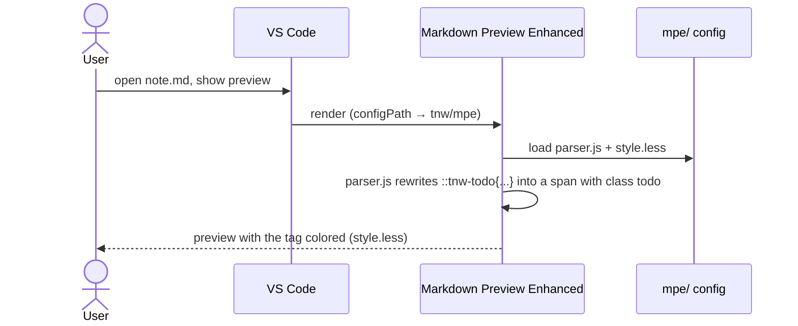
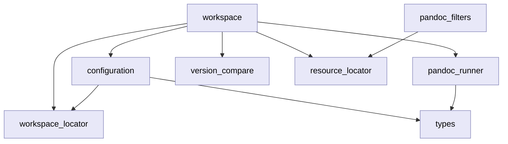
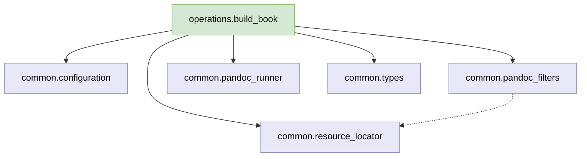
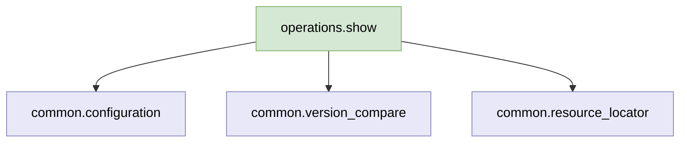
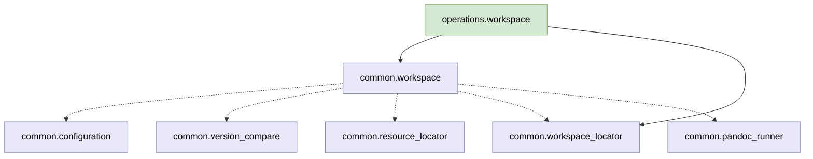

# Software Design

Design of the **Technical Notes Writer** (`tnw`), a command-line tool that manages a workspace of technical notes written in Markdown and converts them to self-contained HTML, rendering PlantUML and Mermaid diagrams. It also ships a Markdown Preview Enhanced (MPE) configuration so the editor preview matches the generated output.

## 1. Scope

`tnw` is a cross-platform Python CLI (Linux, Windows, macOS). It:

- Initializes and inspects a **workspace** (a directory tree with a `.tnw` configuration folder).
- Builds a single note (**report**) or a multi-chapter **book** to a single, self-contained HTML file using pandoc. The HTML needs no network access to be viewed: styles, scripts, images, diagrams and MathJax are embedded.
- Renders **PlantUML** and **Mermaid** diagrams embedded in the notes.
- Ships a **Markdown Preview Enhanced** configuration (`mpe/`) so the VS Code preview renders the same custom markup (e.g. the inline `::tnw-todo{...}` tag) as the generated HTML.

HTML is the only output format. PDF is out of scope; a PDF can be obtained by printing the HTML from a browser (the stylesheet has print rules that hide the sidebar).

It relies on external tools: pandoc (conversion), PlantUML (`plantuml.jar`, run with Java) and the Mermaid CLI (`mmdc`) for diagrams. During editing it integrates with the Markdown Preview Enhanced VS Code extension.

## 2. Overview



Note the two independent rendering paths: the CLI build pipeline (through pandoc) and the in-editor preview (VS Code + Markdown Preview Enhanced reading the `mpe/` config). They are kept visually consistent but do not share code.

The tool is layered:

- **CLI layer** (`tnw_cli/cli.py`, started by `tnw-cli.py`, `python -m tnw_cli` or the installed `tnw` command): argument parsing with `click`; delegates to operations.
- **Operations layer** (`tnw_cli/operations`): one module per use case.
- **Common layer** (`tnw_cli/common`): configuration, workspace discovery and diagnosis, version compatibility, command running and filter-path resolution.
- **Pandoc filters** (`tnw_cli/pandoc-filters`): diagram rendering, the `tnw-todo` tag and citation back-references, run by pandoc as separate processes.
- **Templates and assets** (`tnw_cli/pandoc-templates`, `tnw_cli/pandoc-csl`): the HTML templates, their CSS/JS, the vendored MathJax and the citation style.
- **MPE preview config** (`mpe/`): a parallel, editor-side rendering path consumed by the Markdown Preview Enhanced VS Code extension (not by the CLI).

## 3. Workspace model

A workspace is a directory that contains a `.tnw` folder. Conventions:

- `.tnw/settings.yaml` — configuration (tool commands and the creating tnw version).
- `./build` — generated output (documents and cached diagram images).

`workspace_locator.find_workspace_root` locates the workspace by walking up from the current directory until it finds a `.tnw` folder (same idea as `.git`). This lets commands run from any subdirectory of the workspace. Formally, for a starting directory $d_0$ with ancestors $d_1 = \mathrm{parent}(d_0), d_2, \dots, d_k$ (the filesystem root):

$$
\mathrm{root}(d_0) = d_{i^*}, \qquad i^* = \min\{\, i \in \{0,\dots,k\} \;:\; d_i/\texttt{.tnw} \text{ exists} \,\}
$$

and if the set is empty there is no workspace (`check` reports `[FAIL] Workspace`, the other commands stop with an error).

`settings.yaml` keys:

| Key | Meaning | Notes |
|---|---|---|
| `pandoc_bin` | Command to run pandoc | e.g. `pandoc`; optional, defaults to `pandoc` (on PATH) |
| `plantuml_bin` | Command to run PlantUML | e.g. `java -jar <path>/plantuml.jar`; optional, defaults to `java -jar plantuml.jar` |
| `mermaid_bin` | Command to run the Mermaid CLI | e.g. `mmdc`; optional, defaults to `mmdc` (on PATH) |
| `tnw_version` | tnw version that created the workspace | required, stamped by `init` |

The tool keys are optional — an omitted key means the tool is reachable on PATH (`Configuration` falls back to the defaults above). `tnw_version` is not a user setting — `init` always stamps the running version, and a settings file without it is treated as malformed. `init` writes the omitted keys as comments (`# mermaid_bin: (on PATH)`).

The tool commands are command lines, not just paths: they are split with `shlex` (POSIX rules, or Windows rules on Windows, where surrounding double quotes are removed) and the executable is resolved with `shutil.which`, so `mmdc` finds `mmdc.cmd` on Windows and a path with spaces can be quoted (`java -jar "C:/my tools/plantuml.jar"`).

## 4. Components

### 4.1 CLI (`tnw_cli/cli.py`)

A `click` command group exposing:

| Command | Purpose |
|---|---|
| `--version` / `-v` | Print the `tnw` version and exit. |
| `--help` / `-h` | Print usage; available on the tool and every subcommand. |
| `init [--pandoc C] [--plantuml J] [--mermaid C] [-f]` | Create the workspace (`.tnw/`, `.vscode/`) in the current directory. The tool paths are optional (absent ones default to PATH); `--plantuml` takes the jar path and is stored as `java -jar <jar>`; the running tnw version is stamped. If a workspace already exists, overwrite it after confirmation (`-f` / `--force` skips the prompt). |
| `check` | Report whether the current directory is inside a workspace and diagnose it (directories, settings, tool commands, tnw-version compatibility, VS Code MPE configPath). Exit code 1 when a check fails. |
| `show` | Show workspace information (versions and compatibility, tool commands, directories, MPE config). |
| `build_report html <doc.md> [-b biblio.bib]` | Build one note. |
| `build_book html <config.yaml>` | Build a book from a config. |

The CLI validates arguments (the output format, file existence and extensions: `.md`, `.bib`, `.yaml`/`.yml`) and calls the matching operation. The output format argument is kept so the command reads as documented (`build_report html ...`); any value other than `html` is rejected with "tnw only builds html". `--version` / `-v` and `--help` / `-h` are options on the command group (not subcommands); `-h` is enabled through the group's `help_option_names` context setting, so it also works on each subcommand. Errors raised by the lower layers (`TnwError`) are printed as `Error: ...` with exit code 1, without a traceback.

### 4.2 Configuration (`common/configuration.py`)

Resolves and exposes the workspace paths (`work_directory`, `build_directory`), the tool commands (`pandoc_bin`, `plantuml_bin`, `mermaid_bin`) and the recorded `created_version`. It loads `.tnw/settings.yaml` once on construction through `load_settings`, which `check` also uses. Reading is tolerant for the tool commands (an absent key falls back to its PATH default), while `tnw_version` is required (a missing one raises `ConfigurationError`). An unquoted version such as `0.1` is read as a string.

### 4.3 Build operations

Both builds produce HTML only. Each module has its own private copy of the pandoc helpers (`_html_command`, `_run_build`, `_resolve_existing`, `_has_meta`) and of the constants they use (assets directory, CSL file, `FILTERS`, `META_FIELDS`); the two copies differ only in the template and, for the report, `--shift-heading-level-by=-1`. **A change to one copy must be mirrored in the other.**

- `_html_command` assembles the pandoc command: the configured `pandoc_bin`, `--citeproc`, `--toc`, `--standalone`, `--embed-resources`, the template, the four filters, `--mathjax`, `link-citations`, the tnw version and the per-document metadata, the bibliography with the IEEE CSL when there is one, then the inputs and `-o <build>/<name>.html`.
- `_run_build` prints the command (quoted for the platform's shell, so it can be copied), runs it with `TNW_DOCUMENT_DIR` (the directory paths are resolved against) and `TNW_WORKSPACE_DIR` (the workspace root, read by the diagram filters) in the environment, and raises `TnwError` when pandoc fails, so no partial output is reported as built.
- `--citeproc` is placed before the filters: pandoc applies them in command-line order, so `citation_backrefs` sees the rendered citations.
- `--resource-path` is the assets directory plus the document directory, so the template's CSS/JS/MathJax and the document's relative images are found and embedded.

**Report** (`operations/build_report.py`): builds a single Markdown file with the `tnw_report.html` template.

- The title is the single top-level `#` heading of the body. `count_body_h1` counts ATX and setext level-1 headings, ignoring the front-matter and fenced code; a count other than one, or a `title` key in the front-matter, is rejected before running pandoc. pandoc is run with `--shift-heading-level-by=-1`, which turns that heading into the document title and the `##` sections into the top level of the table of contents.
- The front-matter is read as plain strings (YAML `BaseLoader`) by `read_front_matter`; a missing or invalid front-matter reads as empty. `did`, `version`, `date` and `tags` are passed again with `--metadata`, which takes precedence. pandoc's own YAML reading would otherwise turn `did: 002` into `2` and `version: 1.10` into `1.1`.
- The bibliography is the `-b` option (resolved against the current directory) or else the front-matter `bibliography` (resolved against the document's directory); either is passed to pandoc as an absolute path.
- The output is `<build>/<document stem>.html`.

**Book** (`operations/build_book.py`): builds several chapters into one document with the `tnw_book.html` template. `_read_configuration` reads the YAML config (as plain strings, so `did: 001` stays `001`) and validates it: `title`, `file` (a bare file name) and a non-empty `toc` list are required; `author`, `did`, `version`, `date`, `tags` and `bibliography` are optional. Chapters and the bibliography are resolved relative to the config's directory and must exist. The chapters are passed to pandoc in order, with the metadata forwarded via `--metadata`.

Excerpt of `make_html_book` (`tnw_cli/operations/build_book.py`):

```python
def make_html_book(config_file):
    title, file_name, tags, chapters, biblio, base_dir, data = _read_configuration(config_file)
    configuration = Configuration()

    metadata = [("title", title)]
    metadata += [(field, data[field]) for field in ("did", "version", "author", "date")
                 if data.get(field)]
    metadata += _tags_metadata(tags)
    if _has_meta({**data, "tags": tags}):
        metadata.append(("has_meta", "1"))

    output = os.path.join(configuration.build_directory(), file_name + ".html")
    command = _html_command(configuration, base_dir, chapters, output, metadata, biblio)
    return _run_build(configuration, command, base_dir, output)
```

`has_meta` (computed by `_has_meta`) is set when any of `did`, `version`, `date` or `tags` is present; the template shows the sidebar metadata box only then.

### 4.4 Templates and assets (`pandoc-templates`, `pandoc-csl`)

- `tnw_report.html` and `tnw_book.html` are self-contained and differ only in the body class: each holds the head (meta tags, CSS, highlighting CSS, MathJax), the title header (title, author), the sidebar (metadata box, above the table of contents) and the main content (body, footer with the tnw version). A change to one must be mirrored in the other.
- `assets/tnw-common.css` — layout (centered page, boxed sticky table of contents, responsive below 900 px), light and dark color schemes, the `todo` style, citation and reference styles, print rules.
- `assets/tnw.js` — folds and unfolds the table of contents as an accordion (sections start folded, opening one folds its siblings, *Collapse all* / *Expand all*), highlights the section being read and unfolds it, and shows a popup with the reference (and a *See full reference* link) when a citation is hovered or focused.
- `assets/annotator.js` — lets the reader highlight text and add notes, with a side panel that lists them and exports or imports them as a `.json` file. The annotations are kept in the browser's `localStorage`, one list per page, and found again by their text and the text around it, so they survive a rebuild that does not change that text. The UI lives in a shadow DOM, uses no network, and is hidden when printing.
- `assets/mathjax/tex-svg-full.js` — MathJax 3.2.2, vendored (Apache 2.0). It is referenced only when the document contains math, and embedded by `--embed-resources`. The SVG output carries its fonts inside the script and the `-full` bundle preloads every TeX extension, so nothing is fetched at view time; the MathJax context menu is disabled because its accessibility tools load code from a CDN. MathJax 4 is not used because it loads fonts as separate files.
- `pandoc-csl/ieee-with-url.csl` — the IEEE style from the official CSL repository (which has no separate "with URL" variant; the standard IEEE style already prints URLs as "Available: ...").

### 4.5 Pandoc filters (`pandoc-filters`)

All filters are `panflute` scripts. pandoc runs a `.py` filter with the `python3` / `python` found on PATH, as a separate process; `pandoc_runner.filter_environment` therefore puts the directory of the running interpreter (the one that has `panflute`) first on PATH and adds the directory containing `tnw_cli` to `PYTHONPATH`, so the same mechanism works from a checkout, a virtual environment or a pipx installation. The filters import their sibling modules (`utils`, `diagram_importer`) by name, since a script's directory is on its import path.

The diagram filters are one self-contained filter per engine, and each one handles **two** ways a diagram can appear, in a single `action`:

- `plantuml.py` / `mermaid.py` — each filter handles:
  - a fenced **code block** (class `plantuml` / `mermaid`): the block body is the diagram source;
  - an **import tag** on its own line (`::tnw-puml{file}` / `::tnw-mmd{file}`): the diagram source is read from an external file.

Both branches converge on the filter's own `_render` (the single place that runs `plantuml_bin` / `mermaid_bin`) and on `_image_from_code` (builds the `Para([Image])`). The filter's `prepare` reads the tool command and the build directory from the workspace given by `TNW_WORKSPACE_DIR`.

- PlantUML is run as `<plantuml_bin> -pipe -charset UTF-8 -t<ext>`: the source goes to stdin (wrapped in `@startuml/@enduml` if needed) and the image comes from stdout.
- Mermaid is run as `<mermaid_bin> -i <source> -o <image>`; the source is written to a temporary `.mmd` file next to the image and removed afterwards.



Both diagram filters:

- Pick the image type from the output format: `svg` for HTML, `png` otherwise (only HTML is built by `tnw`; the `png` branch keeps the filters usable with other pandoc outputs).
- Cache images under `build/` keyed by a hash of the diagram source (`utils.filename_for_code`), so a diagram is only re-rendered when it changes. For a code block the cache key is the block text; for an import tag it is the resolved absolute path plus the file content, so editing the imported file produces a new image.
- Check the result in `utils.run_renderer`: a non-zero exit status, a missing image or an empty image raises `RenderError` (an empty image file is removed so it is not cached).

The image file name can be summarised as:

$$
\mathrm{ext}(f) =
\begin{cases}
\texttt{svg} & f = \text{html} \\
\texttt{png} & \text{otherwise}
\end{cases}
\qquad
\mathrm{file}(s) = \texttt{build/}\,e\texttt{-}\mathrm{sha1}(k(s)) \,.\, \mathrm{ext}(f)
$$

where $e$ is the engine (`plantuml` / `mermaid`) and $k(s)$ is the block text for a fenced block, or the absolute path followed by the content for an import tag. A diagram is rendered only when $\mathrm{file}(s)$ does not already exist, so the number of tool invocations in a build equals the number of *distinct* keys not yet in the cache.

Two engine-agnostic support modules back the filters:

- `diagram_importer.py` — everything the import tag needs that is independent of the engine: `lone_tag_path` (recognise a paragraph made only of `::<tag>{...}` — the tag is **block-level**, a tag mixed with text or formatting is left untouched), `resolve_path` (relative to `TNW_DOCUMENT_DIR`; absolute paths are kept), `has_valid_extension` / `classify` (validate the extension against the caller-supplied set and check the file exists), `read_code_from_file`, and `error_marker` (a visible, non-fatal red marker, also reported as a warning on stderr). It never picks a renderer; the per-engine filter reads the file and renders it.
- `utils.py` — stdlib-only `extension`, `filename_for_code`, `run_renderer` and `RenderError`.

The error policy differs by source: a fenced **code block** that fails to render aborts the build (the filter raises, pandoc fails, `tnw` reports the error and exit code 1); a failing **import tag** (missing file, wrong extension, tool error) degrades to the error marker and the build continues.

> Historical note: the diagram filters were originally `pandocfilters` scripts that only handled the fenced code block. They are now `panflute` filters that also cover the import tag, and the project no longer depends on `pandocfilters`.

`todo_tag.py` implements the `tnw-todo` tag in two forms, both rendered as black text on a yellow background:

- **Inline** `::tnw-todo{...}`. `::` is not special in Pandoc Markdown, so the tag reaches the AST as plain text (Pandoc splits content with spaces across several `Str` / `Space` / `SoftBreak` inlines). For every element whose content is a list of inlines (paragraphs, headings, emphasis, table cells, ...), the filter joins each consecutive run of text inlines, matches `::(?:tnw-todo|todo)\{([^}]*)\}`, and replaces each match with a `Span` with class `todo` and an inline `style` (`<span class="todo" style="color:black;background-color:yellow">...</span>`), so the style travels with the span. Code, links, images and citations are not rewritten, and a tag split by formatting (e.g. `::tnw-todo{a *b*}`) is left as text.
- **Block** `::: tnw-todo`. Pandoc already parses the fenced div (both `::: tnw-todo` and `:::tnw-todo`) into a `Div` with class `tnw-todo`, so the filter only adds the inline `style` to it.

> Deprecated spelling: the tag was originally `todo` (`::todo{...}` / `::: todo`, `Div` class `todo`). That spelling is still accepted for backward compatibility — the inline regex matches both and the block handler styles a `Div` with class `tnw-todo` or `todo` — but only `tnw-todo` is documented for users.

`citation_backrefs.py` adds return links from bibliography entries back to the in-text citations. It runs two passes (`run_filters`): the first wraps every `Cite` in a `Span` with id `cite-<n>` (numbered in document order) and records, for every cited key, the anchors citing it; the second appends to each references entry (`Div` with id `ref-<key>`) one link per citation — `↩` when cited once, `↩1`, `↩2`, ... otherwise. For numeric styles such as IEEE, where the entry is split into a label and a `csl-right-inline` text span, the links go inside the text span so they stay on the entry's line. Entries listed through `nocite` have no citation and get no link. The forward link (citation → entry) comes from pandoc's `link-citations`.

`common/pandoc_filters.py` maps a filter name (`plantuml`, `mermaid`, `todo_tag`, `citation_backrefs`) to its file path, which the build operations pass to pandoc.

### 4.6 Markdown Preview Enhanced config (`mpe/`)

`tnw` ships a Markdown Preview Enhanced (MPE) configuration in the `mpe/` directory so the in-editor preview renders the same custom markup as the pandoc output. This is separate from the build pipeline: MPE has its own rendering engine and does not use the pandoc filters, so the same behavior is implemented twice — once as a pandoc filter (`todo_tag.py`) and once as an MPE parser hook.

- `mpe/parser.js` — an `onWillParseMarkdown` hook that chains one render function per tag, all built on `rewriteOutsideCode` (which leaves fenced code untouched). `renderTnwTodo` rewrites the inline `::tnw-todo{...}` into `<span class="todo">...</span>` and the block `::: tnw-todo` fence into `<div class="todo">...</div>` (the JavaScript counterpart of `todo_tag.py`; the deprecated `::todo` / `::: todo` spelling is still accepted). `renderImportTags` rewrites the `::tnw-mmd` / `::tnw-puml` import tags to MPE's native `@import`. The file is an expression that evaluates to the hooks object (an immediately invoked function, so the helpers stay private).
- `mpe/style.less` — colors `.todo` as black text on a yellow background, matching the style emitted by the filter.
- `mpe/config.js`, `mpe/head.html` — MPE defaults.

It is enabled per project with the `markdown-preview-enhanced.configPath` setting pointing at this folder (absolute path; MPE does not expand `${workspaceFolder}`). The folder lives at the repository root so it is versioned together with the matching pandoc filter and templates; the wheel also packages it as `tnw_cli/mpe` (hatchling `force-include`), and `resource_locator.mpe_directory` returns whichever exists, with forward slashes.

### 4.7 Workspace operations (`init` / `check` / `show`)

`operations/workspace.py` and `operations/show.py` cover the workspace lifecycle, delegating the file layout and diagnosis to `common/workspace.py`.

`init` (`create_workspace`) renders `.tnw/settings.yaml` and `.vscode/settings.json` from the templates in `tnw_cli/templates/` (values are written as JSON-escaped strings, valid in both YAML and JSON, so Windows backslashes survive), then locates a workspace by walking up for a `.tnw` (the same search `check` uses).

- No workspace found: create one in the current directory. The build is atomic — if any of `.tnw/`, `.tnw/settings.yaml`, `.vscode/` or `.vscode/settings.json` already exists, it creates nothing and reports the conflict.
- Workspace found: reinitializing OVERWRITES it. After warning and recommending a backup of `.tnw`, it asks for confirmation (default No; `-f` / `--force` skips the prompt), then removes the existing `.tnw` and `.vscode` directories and rebuilds from clean at the found workspace root (so it never creates a nested workspace). Because the rebuild reuses the atomic create, the whole `.vscode` directory is regenerated, not just `settings.json`.

The confirmation is injected as a callback so the operation stays UI-agnostic (the CLI passes `click.confirm`).



`check` (`diagnose_workspace`) returns a list of `CheckResult(name, status, detail)` where `status` is `Status.OK` / `WARNING` / `FAIL`:

| Check | FAIL | WARNING |
|---|---|---|
| `Workspace` | no `.tnw` here or in any parent (the only line printed) | — |
| `tnw settings` | missing or malformed `settings.yaml` (the checks below are skipped) | — |
| `tnw version` | see the compatibility table below | minor version differs |
| `pandoc_bin` | executable not found | — |
| `plantuml_bin` | — | executable (`java`) or jar file not found |
| `mermaid_bin` | — | executable not found |
| `VS Code directory` / `VS Code settings` | — | missing, or `settings.json` is not valid JSON |
| `MPE configPath` | — | not set, or not tnw's `mpe/` directory |

pandoc is needed by every build, so its absence fails the check; PlantUML and Mermaid are needed only by documents with diagrams, and VS Code only for editing, so their problems are warnings. The workspace is "healthy" when no check is `FAIL`; `tnw check` exits with code 1 otherwise.

**Version compatibility** (`common/version_compare.compare`) compares the recorded `tnw_version` against the installed version, by `major.minor` (patch ignored):

| Situation | Verdict |
|---|---|
| Either version unparseable | FAIL |
| Installed older than the workspace | FAIL |
| Different major | FAIL |
| Same major, different minor | WARNING |
| Same major and minor | OK |

With the workspace version $w = (w_1, w_2, w_3)$ and the installed version $v = (v_1, v_2, v_3)$:

$$
\mathrm{compare}(w, v) =
\begin{cases}
\text{FAIL} & w \text{ or } v \text{ unparseable} \\
\text{FAIL} & v < w \\
\text{FAIL} & v_1 \neq w_1 \\
\text{WARNING} & v_1 = w_1 \;\wedge\; v_2 \neq w_2 \\
\text{OK} & v_1 = w_1 \;\wedge\; v_2 = w_2
\end{cases}
$$

Versions are `major.minor[.patch]`, optionally prefixed with `v`; a missing patch counts as 0. `compare` returns a `Compatibility` enum (`OK` / `WARNING` / `FAIL`), which the diagnosis maps to a `Status`. The enums carry no display text: the operations layer owns how each is shown (`check` prints `[OK ]` / `[WARN]` / `[FAIL]`; `show` prints `compatible`, `compatible (minor version differs)` or `incompatible`).

`show` (`show_information`) prints the workspace and installed tnw versions and their compatibility, the tool commands (pandoc/PlantUML/Mermaid), the resolved directories, and the MPE config path. It only reports configuration values (all from `Configuration`); it does not read or validate `.vscode/settings.json` — that validation is a `check` concern.

## 5. Build flow

### 5.1 CLI build (pandoc)



### 5.2 Editor preview (Markdown Preview Enhanced)

This path does not go through the CLI or pandoc; MPE renders the note live inside VS Code using the `mpe/` configuration, so custom markup such as `::tnw-todo{...}` looks the same while editing as in the generated output.



## 6. Module dependencies

Solid arrows are direct imports from the operation; dotted arrows are the transitive dependencies between `common` modules.

### 6.1 common

Internal dependencies within `common` (arrows mean "imports from"; `types`, `resource_locator`, `version_compare` and `workspace_locator` have no intra-`common` dependencies, and `pandoc_runner` depends only on `types`):



### 6.2 build_report


### 6.3 build_book

Same dependencies as `build_report`.



### 6.4 show



### 6.5 workspace



### 6.6 pandoc filters

The filters are scripts, not package modules. The diagram filters import `utils` and `diagram_importer` (siblings) and, from the package, `common.configuration` (in `prepare`) and `common.pandoc_runner.split_command`. `todo_tag` and `citation_backrefs` depend only on `panflute`.

## 7. Key design decisions

- **HTML only, self-contained and offline.** Each build produces one HTML file with everything embedded (`--embed-resources`): styles, scripts, images, diagrams and, when the document has math, MathJax. The file can be mailed or archived and opens without network access. The cost is size: a document with math is about 2.3 MB (MathJax), one without math stays small. PDF generation was dropped; printing the HTML from a browser gives a clean PDF thanks to the print stylesheet.
- **Cross-platform.** Paths use `pathlib`/`os.path`, tool commands are split per platform and resolved with `shutil.which`, generated settings use forward slashes, and the filters run with tnw's own interpreter whatever the platform's Python launcher is called.
- **Reuse pandoc filters for diagrams.** Diagrams are rendered by external tools at build time and embedded as images, keeping the Markdown portable and the rendering pluggable per language.
- **Two diagram engines, one mechanism.** PlantUML and Mermaid share the same filter pattern; adding Mermaid meant adding a filter, a config key, and wiring it into the build commands — no change to the core flow.
- **Workspace discovery by walking up directories.** Commands work from any subdirectory, like version-control tools.
- **Image caching by content hash.** Avoids re-rendering unchanged diagrams; imported diagrams hash their path and content so edits are picked up.
- **Configurable tool commands with PATH defaults.** `pandoc`, PlantUML and Mermaid are read from `settings.yaml` but optional: an absent key means "it is on PATH". This keeps a fresh `init` zero-config on a machine where the tools are installed, while still allowing explicit paths.
- **Stamp and check the creating tnw version.** `init` records `tnw_version`; `check` / `show` compare it to the installed version (by major.minor) and flag incompatibilities. The verdict is a plain enum in the domain; whether a difference is OK/WARNING/FAIL and how it is shown is decided above the domain.
- **`init` overwrites instead of a separate `update`.** Reinitializing an existing workspace overwrites it (confirmed, backup-recommended, `-f` to force) by deleting and rebuilding, reusing the atomic create. This was chosen over a dedicated `update` command with selective/merging edits, which was judged too complex for the benefit.
- **Presentation lives in the operations, not the domain.** `common` exposes facts (`Status`, `Compatibility`, `is_failure`); the display strings (`[OK ]`, `compatible`, …) are owned by `check` / `show`.
- **Metadata values are kept as written.** `book.yaml` and the report front-matter are read as plain strings and passed to pandoc with `--metadata`, so identifiers such as `001` or versions such as `1.10` are not turned into numbers.
- **`tnw-todo` tag via a filter (inline and block).** Highlighted notes are written inline as `::tnw-todo{...}` or as a block `::: tnw-todo ... :::` (the deprecated `todo` spelling still works) and rendered by a filter as a styled span/div (black text on a yellow background), mirroring the Markdown Preview Enhanced preview and the Better TODO Tree highlight so the tag looks the same while editing and in the output. The inline `::` prefix is used instead of `@` because `@` starts a citation in Pandoc Markdown and would be misread by citeproc; the block form reuses Pandoc's native fenced divs.

## 8. External dependencies

| Dependency | Used for | Required when |
|---|---|---|
| Python ≥ 3.10 with `click`, `PyYAML`, `panflute`, `tabulate` | CLI, config, filters | Always |
| pandoc (tested with 3.7) | Markdown → HTML | Building |
| PlantUML (`plantuml.jar`, needs Java) | PlantUML diagrams | Notes with PlantUML |
| Mermaid CLI (`mmdc`, needs Node.js) | Mermaid diagrams | Notes with Mermaid |
| Markdown Preview Enhanced (VS Code extension) | In-editor preview matching the output (`mpe/` config) | Editing/previewing notes in VS Code |
| MathJax 3.2.2 | Math rendering | Vendored in the package, nothing to install |

## 9. Limitations and notes

- HTML is the only output format.
- The PlantUML CLI depends on Java; the Mermaid CLI depends on Node.js (and a headless Chromium, which `mmdc` installs).
- Markdown Preview Enhanced (MPE) is needed to render the custom markdown tags in the editor preview.
- A tag is plain text to pandoc: an inline `::tnw-todo{...}` whose content contains formatting (emphasis, code, links) is not recognized by the filter.
- Documents with math embed MathJax and weigh about 2.3 MB.
