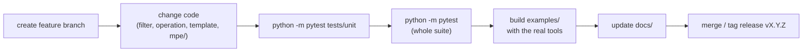
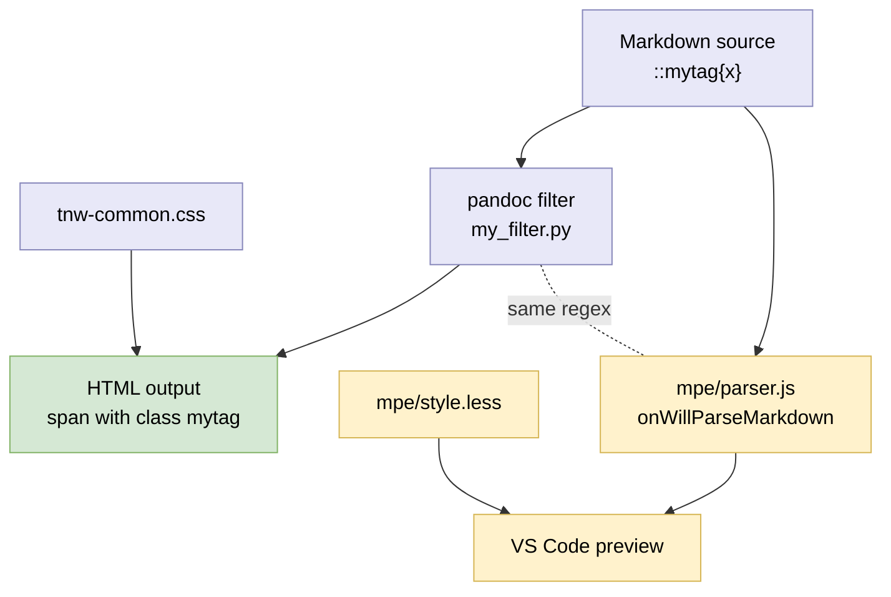

# Development process

This document gathers what a developer needs to work on `tnw` itself: the repository layout, how to extend it (new pandoc filters and new tags), how it is tested, and the list of pending improvements.

## Repository layout

```text
tnw/
├── docs/
│   ├── design.md
│   ├── dev-process.md
│   ├── testing.md
│   ├── user-manual.md
│   └── work-setup.md
├── examples/
│   ├── book/
│   │   ├── diagrams/
│   │   │   ├── flow.mmd
│   │   │   └── schema.puml
│   │   ├── images/
│   │   │   └── tnw-logo.svg
│   │   ├── book.yaml
│   │   ├── chapter1_intro.md
│   │   ├── chapter2_figures.md
│   │   ├── chapter3_math.md
│   │   ├── chapter4_notes_links.md
│   │   ├── chapter5_conclusions.md
│   │   ├── references.md
│   │   └── refs.bib
│   ├── report/
│   │   ├── diagrams/
│   │   ├── images/
│   │   ├── example-report.md
│   │   └── refs.bib
│   └── report_no_biblio/
│       ├── diagrams/
│       ├── images/
│       └── example-report-no-biblio.md
├── mpe/
│   ├── config.js
│   ├── head.html
│   ├── parser.js
│   └── style.less
├── tests/
│   ├── acceptance/
│   │   ├── fake_tools/
│   │   └── conftest.py, test_*.py
│   └── unit/
│       └── conftest.py, test_*.py
├── tnw_cli/
│   ├── common/
│   │   ├── __init__.py
│   │   ├── configuration.py
│   │   ├── pandoc_filters.py
│   │   ├── pandoc_runner.py
│   │   ├── resource_locator.py
│   │   ├── types.py
│   │   ├── version_compare.py
│   │   ├── workspace_locator.py
│   │   └── workspace.py
│   ├── operations/
│   │   ├── __init__.py
│   │   ├── build_book.py
│   │   ├── build_report.py
│   │   ├── show.py
│   │   └── workspace.py
│   ├── pandoc-csl/
│   │   └── ieee-with-url.csl
│   ├── pandoc-filters/
│   │   ├── citation_backrefs.py
│   │   ├── diagram_importer.py
│   │   ├── mermaid.py
│   │   ├── plantuml.py
│   │   ├── todo_tag.py
│   │   └── utils.py
│   ├── pandoc-templates/
│   │   ├── assets/
│   │   │   ├── annotator.js
│   │   │   ├── mathjax/
│   │   │   │   ├── LICENSE
│   │   │   │   ├── README.md
│   │   │   │   └── tex-svg-full.js
│   │   │   ├── tnw-common.css
│   │   │   └── tnw.js
│   │   ├── tnw_book.html
│   │   └── tnw_report.html
│   ├── templates/
│   │   ├── tnw-settings.yaml.template
│   │   └── vsc-settings.json.template
│   ├── __init__.py
│   ├── __main__.py
│   └── cli.py
├── .gitignore
├── pyproject.toml
├── pytest.ini
├── README.md
├── requirements-dev.txt
├── requirements.txt
└── tnw-cli.py
```

Main responsibilities (see the Software Design document for details):

| Path | Role |
|---|---|
| `tnw-cli.py`, `tnw_cli/__main__.py`, `tnw_cli/cli.py` | CLI layer (`click` command group) and its entry points. |
| `tnw_cli/operations/` | One module per use case (`build_report`, `build_book`, `show`, `workspace`). |
| `tnw_cli/common/` | Configuration, workspace discovery/layout/diagnosis, version compatibility, command running, filter-path resolution. |
| `tnw_cli/pandoc-filters/` | panflute filters run by pandoc (diagrams, `tnw-todo` tag, citation back-references) and their support modules. |
| `tnw_cli/pandoc-templates/` | HTML templates (`tnw_report.html`, `tnw_book.html`) and their assets, including the vendored MathJax. |
| `tnw_cli/pandoc-csl/` | Citation style (IEEE). |
| `tnw_cli/templates/` | Templates written by `init` (`settings.yaml`, `.vscode/settings.json`). |
| `mpe/` | Markdown Preview Enhanced configuration (editor-side rendering path); packaged as `tnw_cli/mpe` in the wheel. |
| `examples/` | Example book and reports, also used by the acceptance tests and as manual test material. |
| `tests/` | Acceptance and unit tests, and the fake diagram tools. |

The package version is `__version__` in `tnw_cli/__init__.py`; `pyproject.toml` reads it from there (hatchling).

## Working from a checkout

Instead of installing a released package (see the user manual), you can work directly from a clone of the repository.

Linux / macOS:

```sh
git clone ssh://git@oatbitbucket.am.omron.net:7999/frc-sc/tech-notes_writer.git tnw
cd tnw
python3 -m venv .venv
. .venv/bin/activate
pip install -r requirements.txt -r requirements-dev.txt
python tnw-cli.py --version
```

Windows (PowerShell):

```powershell
git clone ssh://git@oatbitbucket.am.omron.net:7999/frc-sc/tech-notes_writer.git tnw
cd tnw
python -m venv .venv
.venv\Scripts\activate
pip install -r requirements.txt -r requirements-dev.txt
python tnw-cli.py --version
```

`python tnw-cli.py <command>` (or `python -m tnw_cli <command>`) runs the CLI from the checkout — it is the same entry point the acceptance tests use. `pip install -e .` installs the `tnw` command in the virtual environment, pointing at the checkout. Work is done on feature branches (e.g. `feature/fix-silent-failure`).

## Development workflow



- Run the fast unit tests while iterating; run the whole suite before merging. It needs only pandoc: the diagram tools are faked (see the Testing document).
- The suite does not run the real PlantUML and Mermaid CLI. When touching the diagram filters, build the examples in a workspace configured with the real tools and check the output visually, both in the browser and in the MPE preview:

  ```sh
  mkdir -p /tmp/tnw-check && cp -r examples /tmp/tnw-check/ && cd /tmp/tnw-check
  python <checkout>/tnw-cli.py init --plantuml /path/to/plantuml.jar --mermaid mmdc
  python <checkout>/tnw-cli.py check
  python <checkout>/tnw-cli.py build_book html examples/book/book.yaml
  python <checkout>/tnw-cli.py build_report html examples/report/example-report.md
  ```

- Releases are git tags (`v0.1.1`, …) matching `__version__`; users install them with `pipx install "git+ssh://...@<tag>"`. Workspaces record the `tnw_version` that created them, and `check` compares it by `major.minor`, so a minor version bump makes existing workspaces report `[WARN]` and a major bump reports `[FAIL]`.
- After a change to the packaged files (templates, assets, `mpe/`), check that the wheel still contains them: `pip wheel --no-deps -w dist .` and list the archive.

## How-to

### Adding a pandoc filter

A pandoc filter transforms the document AST during a build. All filters in the repo are `panflute` scripts (`plantuml.py`, `mermaid.py`, `todo_tag.py`, `citation_backrefs.py`).

Steps:

1. **Create the filter script** under `tnw_cli/pandoc-filters/`, e.g. `my_filter.py`. With `panflute`, implement an `action(elem, doc)` callback and run it from `main()`:

   ```python
   #!/usr/bin/env python3
   import panflute as pf

   def action(elem, doc):
       # inspect/replace elements here; return a new element, [] to delete,
       # or None to leave it unchanged.
       return None

   def main(doc=None):
       return pf.run_filter(action, doc=doc)

   if __name__ == "__main__":
       main()
   ```

   The filter runs in its own process, started by pandoc with tnw's Python (see `pandoc_runner.filter_environment`): it can import `panflute`, its sibling modules in `pandoc-filters/` and the `tnw_cli` package. Workspace-dependent settings are read in a `prepare(doc)` function from `TNW_WORKSPACE_DIR` (as the diagram filters do); paths in the document are resolved against `TNW_DOCUMENT_DIR`.

2. **Register it** in `common/pandoc_filters.py` (`FILTERS`), which maps a filter name to its file path.

3. **Wire it into the build commands** by adding its name to `FILTERS` in both `operations/build_report.py` and `operations/build_book.py`. The order matters: filters run in command-line order, after `--citeproc`.

4. **If the filter needs styling**, add the CSS to `pandoc-templates/assets/tnw-common.css` (or emit an inline `style`, as `todo_tag.py` does).

5. **Test it** with unit tests against the panflute AST (see `tests/unit/test_todo_tag.py`) and an acceptance test through the real pandoc (see `tests/acceptance/test_filters_pandoc.py`). To try it quickly from the command line, run pandoc with the same environment the builds use:

   ```sh
   echo "text with ::mytag{x}" | python -c "import subprocess, sys; \
   from tnw_cli.common.pandoc_runner import filter_environment; \
   sys.exit(subprocess.run(['pandoc', '-t', 'html', '--filter', 'tnw_cli/pandoc-filters/my_filter.py'], \
   env=filter_environment()).returncode)"
   ```

### Adding a tag to the MPE preview (`mpe/`)

MPE has its own rendering engine and does **not** use the pandoc filters, so the same tag must also be implemented in the `mpe/` config to show up in the preview.

Steps:

1. **Transform the markup in `mpe/parser.js`.** Each tag has its own render function (`renderTnwTodo`, `renderImportTags`) built on `rewriteOutsideCode`, which skips fenced code and hands every other line to a callback. Add a function that rewrites the tag into HTML with a class, mirroring the pandoc filter's HTML output so the class names match, and chain it in `onWillParseMarkdown`:

   ```javascript
   function renderMyTag(markdown) {
     var MY_TAG = /::mytag\{([^}]*)\}/g;

     return rewriteOutsideCode(markdown, function (line) {
       return line.replace(MY_TAG, function (_match, content) {
         return '<span class="mytag">' + content + "</span>";
       });
     });
   }

   // in the returned object:
   onWillParseMarkdown: async function (markdown) {
     return renderMyTag(renderImportTags(renderTnwTodo(markdown)));
   },
   ```

   Keep the regex identical to the one in the pandoc filter so both paths accept the same syntax, and add a case to `tests/unit/test_mpe_parser.py`.

2. **Style the class in `mpe/style.less`**, nested under `.markdown-preview`, with the same color used in `tnw-common.css` so the preview and the output match:

   ```less
   .markdown-preview.markdown-preview {
     .mytag { color: #1e6bff; }
   }
   ```

3. **Reload MPE.** It caches its configuration, so after editing `mpe/parser.js` or `mpe/style.less` reload the VS Code window (or run "Markdown Preview Enhanced: Refresh Preview") so the changes take effect.

> Consistency tip: keep the tag syntax and the color in sync across `todo_tag.py` (or your new filter), `tnw-common.css` and the `mpe/` files; otherwise you get "it works in the preview but not in the output" (or vice versa).



### Updating the vendored MathJax

`tnw_cli/pandoc-templates/assets/mathjax/tex-svg-full.js` comes from the `mathjax` npm package (`es5/tex-svg-full.js`, version in its `README.md`). To update it, replace the file and its `LICENSE`, keep a bundle that embeds its fonts (MathJax 3 SVG output; MathJax 4 loads fonts separately and would break offline viewing), and check that a generated document renders its math with the network disabled.

## To-do

This is a list of missing functionality and potential improvements of the tool:

- [ ] Test the diagram filters against the real PlantUML and Mermaid CLI on Linux and Windows, and add a CI job that does it (`mmdc` may need a puppeteer configuration with `--no-sandbox` on Linux).
- [ ] Create a video explaining what TNW is and how to use it.
- [ ] Create a `version` module in `common` that does the functionality related to versions in addition to compatibility.
- [ ] Review `workspace` in `common` and split it into several functionalities if possible.
- [ ] Manage issues (improvements, bugs) locally using markdown files instead of external DBs like Jira.
- [ ] Consider deleting "notes" and "cards", as the Tag Tree plugin of VS Code could be used. Check if it provides enough functionality.
- [ ] Integrate "notes" and "cards" in only one class.
- [ ] Recognize an inline `::tnw-todo{...}` whose content contains formatting (emphasis, code, links).
- [ ] Center diagrams like figures (they are plain image paragraphs today).
- [x] Migrate pandoc filters using `pandocfilters` to `panflute`.
- [x] Make it work on GNU/Linux (cross-platform).
- [x] Remove PDF generation: HTML is the only output (print to PDF from a browser).
- [x] Make the generated HTML independent of the network (MathJax embedded).
