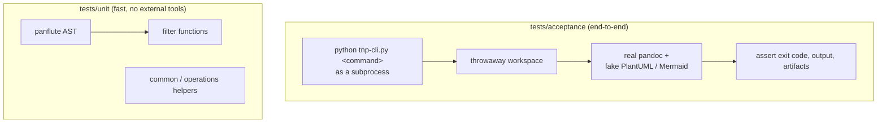

# Testing

The `tnp` test suite lives under `tests/` and has two layers:

- **Acceptance tests** (`tests/acceptance`) — end-to-end tests that drive the real CLI against a throwaway workspace and verify the generated artifacts. They need pandoc; the diagram tools are replaced by fakes, so neither Java/PlantUML nor the Mermaid CLI is required.
- **Unit tests** (`tests/unit`) — fast tests of the Pandoc filter logic against the panflute AST and of the `common` / `operations` helpers, with no pandoc process and no external tools.



Both run together with a single command from the project root (with the development requirements installed, see the [Development process](dev-process.md) document):

```sh
python -m pytest
```

No environment variables are needed. The tests that need pandoc are skipped automatically when it is not on PATH. `pytest.ini` sets `testpaths = tests` and `pythonpath = .`, so `tnp_cli` is imported from the checkout without installing it.

To measure code coverage, add `--cov` (`--cov-report=html` also writes a browsable report to `htmlcov/`):

```sh
python -m pytest --cov
```

The acceptance tests run the CLI as a subprocess and pandoc runs the filters as separate processes, so `pyproject.toml` sets `patch = ["subprocess"]` in `[tool.coverage.run]`: coverage follows those Python subprocesses too, and the report covers the CLI and the filters, not just the code imported by pytest. The CI workflow runs the suite with coverage and shows the report in each run's summary, with the HTML report attached as an artifact.

The suite runs on Linux and Windows (see the CI workflow), so write tests that do not depend on the platform:

- Pass `encoding="utf-8"` to every text-mode `open`, `read_text` and `write_text`, and to every `subprocess.run(..., text=True)`. Without it, Windows uses the locale encoding (cp1252) and fails on the UTF-8 that pandoc writes. The `tnp` fixture also sets `PYTHONIOENCODING=utf-8` so the CLI writes its output in UTF-8.
- Build expected paths the way the CLI does, from its working directory (`workdir`), not from the directory pytest runs in: on Windows a path such as `/opt/x` takes the drive of the current directory, and the two may differ.

## Acceptance tests

Each test launches the real CLI (`python tnp-cli.py <command>`, with the interpreter running the tests) as a subprocess in a pytest temporary directory, and verifies the real result: process exit code, printed output, and the HTML actually produced by pandoc.

### Fake diagram tools

`tests/acceptance/fake_tools/` holds two small Python scripts that stand in for the diagram tools, so the diagram pipeline (pandoc → filter → workspace configuration → tool → embedded image) is exercised on any machine:

| Script | Replaces | Behavior |
|---|---|---|
| `fake_plantuml.py` | `java -jar plantuml.jar -pipe -t<ext>` | Reads the source on stdin, writes an SVG with the text `fake plantuml <n> lines` on stdout. |
| `fake_mmdc.py` | `mmdc -i <source> -o <image>` | Writes an SVG with the text `fake mermaid <n> lines` to the `-o` file. |

Both exit with status 1 when the diagram source contains `FAIL`, to test the error handling. The `fake_workspace` fixture writes a `.tnp/settings.yaml` whose `plantuml_bin` / `mermaid_bin` run these scripts with the test interpreter (a quoted `"python" "script"` command line, so it works on every platform); `examples_workspace` also copies the repository `examples/` into it. Since pandoc embeds images as base64 data URIs, the `embedded_svgs` helper decodes them so a test can check which diagram ended up in the page.

### What is covered

| File | Scope |
|---|---|
| `test_cli_smoke.py` | `--version` / `-v`, `-h` listing the commands, help on a subcommand (no external tools). |
| `test_workspace.py` | `init` (settings written, reinitialize declined / forced from a subdirectory, refusal on a stray `.vscode/settings.json`), `check`, `show` from a subdirectory (no external tools). |
| `test_filters_pandoc.py` | The filters run by the real pandoc through `filter_environment`: `todo_tag` and `citation_backrefs`, and the Mermaid filter reading the workspace configuration with a fake `mmdc` (POSIX only). |
| `test_templates.py` | Both templates: structure, embedded assets and MathJax, metadata box shown/hidden, MathJax left out of documents without math. |
| `test_build_report_html.py` | `build_report html` on the example report: title, metadata (kept as written, e.g. `007`, `1.10`), TOC, `tnp-todo`, embedded PlantUML + Mermaid images (inline and imported) and image, citations and back-links, output to the workspace `build/` from any directory, report without bibliography (no citations, same diagrams and image), `-b` override, `pdf` and wrong extensions rejected, running outside a workspace. |
| `test_build_book_html.py` | `build_book html` on the example book: title and metadata from `book.yaml`, chapters in TOC order, embedded diagrams and image, `tnp-todo`, bibliography with `nocite` and numbered back-links, missing chapter reported. |
| `test_report_title_toc.py` | The report title rule: the single `#` becomes the title and the `##` sections the TOC; a front-matter `title`, no `#` or two `#` are rejected without output. |
| `test_import_diagram.py` | Import tags resolved relative to the document; a missing file, a wrong extension or a failing tool shows the error marker and the build continues; a failing fenced block aborts the build. |

### Requirements

- [pandoc](https://pandoc.org) on PATH (the tests that need it are skipped otherwise).
- Python with the project and development requirements.

The real PlantUML and Mermaid CLI are not used by the suite. To check them, build the examples in a workspace configured with the real tools (see the [Development process](dev-process.md) document).

## Unit tests

The unit tests exercise the Pandoc filter logic directly against the panflute AST (the filters' directory is added to `sys.path` by `tests/unit/conftest.py`), and the `common` and `operations` helpers, with no pandoc process and no external tools. The diagram tools are replaced by a fake `subprocess.run`.

```sh
python -m pytest tests/unit
```

### What is covered

| File | Scope |
|---|---|
| `test_todo_tag.py` | `todo_tag` filter: inline/block `::tnp-todo` (and the deprecated `::todo`), several and empty tags, tags across soft breaks, in headings and emphasis, code left untouched. |
| `test_citation_backrefs.py` | `citation_backrefs` filter: citation anchoring, numbered back-reference links, placement inside the IEEE `csl-right-inline` text, uncited entries. |
| `test_diagram_filters.py` | `plantuml` and `mermaid` filters: dispatch, `@startuml` auto-wrap, verbatim Mermaid source and temporary file cleanup, extension per format, caching, re-render when an imported file changes, error handling (non-zero exit / missing / empty image aborts a fenced block; import failures become markers). |
| `test_import_tag.py` | `diagram_importer`: lone-tag recognition (paths with spaces, tags mixed with text ignored), path resolution, extension and existence checks, error marker. |
| `test_filters_smoke.py` | The filter modules load and expose their entry points; filter-path resolution. |
| `test_configuration.py` | `Configuration`: PATH defaults, explicit tool commands, discovery from a subdirectory, unquoted versions, missing `tnp_version`, malformed settings, no workspace. |
| `test_version_compare.py` | `version_compare.compare` and `parse` (see below). |
| `test_mpe_parser.py` | `mpe/parser.js`, evaluated with Node.js (skipped without it): inline and block `tnp-todo` (other divs untouched), import tags to `@import`, fenced code untouched, hooks exposed. |
| `test_split_command.py` | Splitting tool commands on POSIX and Windows rules (quoted paths with spaces) and resolving the executable on PATH. |
| `test_vscode_settings.py` | Rendering of `.vscode/settings.json` (valid JSON, `configPath` substituted, Windows backslashes escaped) and of `.tnp/settings.yaml` (absent tools omitted). |
| `test_build_workspace.py` | `build_workspace`: atomic creation of the `.tnp` / `.vscode` layout (clean root creates both files; refuses without touching anything when `.tnp` or `.vscode/settings.json` already exists); `remove_workspace`. |
| `test_diagnose_workspace.py` | `diagnose_workspace`: no workspace, fully configured, missing settings, configPath mismatch, version warnings and failures, missing optional tool (warning) and missing pandoc (failure). |
| `test_read_front_matter.py` | `read_front_matter`: present, absent, invalid or non-mapping front-matter; scalars kept as written. |
| `test_count_body_h1.py` | `count_body_h1`: ATX and setext headings, front-matter and fenced code ignored. |
| `test_report_output_path.py` | The report output path (`<build>/<stem>.html`). |
| `test_book_configuration.py` | `_read_configuration`: values kept as written, optional fields, every validation error. |

### Coverage of the version-compatibility rule

`test_version_compare.py` targets `common/version_compare.compare`, whose verdict for workspace version $w$ and installed version $v$ (compared by `major.minor`, patch ignored) is:

$$
\mathrm{compare}(w, v) =
\begin{cases}
\text{FAIL} & w \text{ or } v \text{ unparseable},\ v < w, \text{ or } v_1 \neq w_1 \\
\text{WARNING} & v_1 = w_1 \;\wedge\; v_2 \neq w_2 \\
\text{OK} & v_1 = w_1 \;\wedge\; v_2 = w_2
\end{cases}
$$

so each branch of the piecewise definition is a natural test case.
