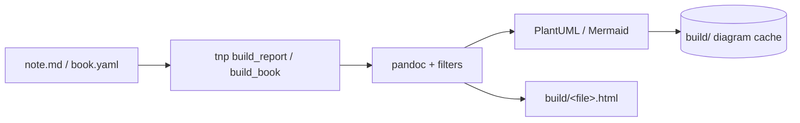
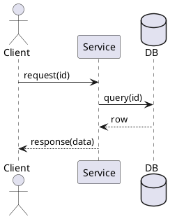
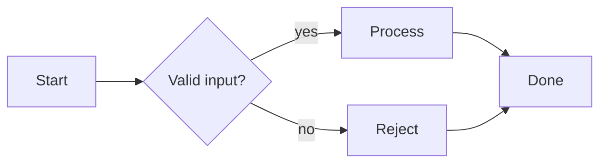

# User Manual

## Installation

### Prerequisites

`tnp` runs on Linux and Windows. It needs Python 3.10 or later and drives external tools that are your responsibility to install; set up the ones you need and make sure they are reachable on your `PATH` (or give their paths to `tnp init`):

1. [pandoc](https://pandoc.org) — required.
2. [PlantUML](https://plantuml.com) — needed for PlantUML diagrams. It is a `plantuml.jar` file run with a Java runtime.
3. [Mermaid CLI](https://github.com/mermaid-js/mermaid-cli) — needed for Mermaid diagrams. Requires Node.js and is installed with `npm install -g @mermaid-js/mermaid-cli` (this provides the `mmdc` command).
4. [Visual Studio Code](https://code.visualstudio.com) and its extensions — optional, only to write and preview the notes in VS Code (the MPE preview, tag browsing and spell checking). Not needed to build with `tnp`. See [Visual Studio Code as IDE to write the notes](#visual-studio-code-as-ide-to-write-the-notes) for the full list of extensions.

`tnp` produces HTML only. The generated file is self-contained (styles, scripts, images, diagrams and the MathJax used for formulas are embedded), so it opens without network access. To get a PDF, open the HTML in a browser and print it to PDF; the page has print styles that hide the sidebar.

### Install tnp

`tnp` is not published on PyPI; install it directly from the repository. You need `git` installed.

Install a released version by pinning its tag with `@<tag>`. Use [pipx](https://pipx.pypa.io) (recommended, isolates the tool in its own environment):

```sh
pipx install "git+https://github.com/dgerod/tnp.git@v0.1.1"
```

Or with `pip` (preferably inside a virtual environment):

```sh
pip install "git+https://github.com/dgerod/tnp.git@v0.1.1"
```

Replace `v0.1.1` with the release you want. Pinning a tag installs a known release; without a `@<tag>` you would get whatever is on the default branch, which may be unreleased work in progress. Either command builds `tnp` from the repository and exposes a `tnp` command on your `PATH`. Check it with `tnp --version`.

### Initialize a workspace

Initialize the workspace with `tnp init` (see [How to use the command line](#how-to-use-the-command-line) below). This generates `.tnp/settings.yaml` (the tool commands and the creating tnp version) and `.vscode/settings.json` (pointing the VS Code MPE preview at `tnp`'s `mpe/` directory). The tool paths are optional options (`--pandoc`, `--plantuml`, `--mermaid`); any you omit are assumed to be on your `PATH`. To set it up by hand instead, see *Setting up a `tnp` workspace manually* (work-setup).

If you want to work from a checkout of the repository instead of an installed package, see *Development* (dev-process).

## How to use the command line

Show the `tnp` version, or the help. `--version` (or `-v`) prints the version and exits; `--help` (or `-h`) prints the usage, on the tool itself and on any subcommand (e.g. `tnp build_report --help`).

```sh
tnp --version
tnp --help
```

### `init`

Initialize a directory as a workspace. The tool paths are optional: pass `--plantuml` with the path to "plantuml.jar" (it is stored as `java -jar <path>`), `--mermaid` with the Mermaid CLI command, and `--pandoc` with the pandoc command; any you omit default to the tool being on your `PATH`.

```sh
cd ~/my-notes
tnp init --plantuml ~/tools/plantuml.jar --mermaid mmdc
```

On Windows:

```powershell
cd $env:USERPROFILE\my-notes
tnp init --plantuml "C:/ProgramData/plantuml/tools/plantuml.jar" --mermaid "mmdc"
```

`init` creates `.tnp/settings.yaml` (the `tnp` configuration, including the creating tnp version) and `.vscode/settings.json` (the VS Code configuration, with `markdown-preview-enhanced.configPath` pointing at `tnp`'s own `mpe/` directory). If `.vscode/settings.json` already exists (without a `.tnp`), `init` creates nothing and reports the conflict, so an existing file is never touched.

If a workspace already exists (a `.tnp` is found in the current directory or a parent), `init` reinitializes it at that workspace root: it warns, recommends backing up `.tnp`, and asks for confirmation before OVERWRITING the `.tnp` and `.vscode` directories (both are deleted and generated again). Pass `-f` / `--force` to overwrite without the prompt:

```sh
tnp init -f --plantuml ~/tools/plantuml.jar
```

If you prefer to set up the workspace by hand (or want to understand exactly what `init` does), see *Setting up a `tnp` workspace manually*.

### `check`

Check whether the current workspace is correctly configured. `check` walks up to the workspace root and reports one line per check: the `tnp` directory and its settings file, the tnp-version compatibility (the version that created the workspace vs the installed one), the tool commands (`pandoc_bin`, `plantuml_bin`, `mermaid_bin`: is the program found, and for PlantUML the jar file), the `.vscode` directory and its settings file, and whether the VS Code MPE `configPath` matches `tnp`'s `mpe/` directory. Each line is prefixed with `[OK ]`, `[WARN]` or `[FAIL]`; the workspace is correctly configured when no line is `[FAIL]`, and `tnp check` then exits with code 0.

A `[WARN]` is not a failure: a minor tnp-version difference, a PlantUML or Mermaid that cannot be found (only documents with diagrams need them) and any VS Code problem (only editing needs it) are warnings. A missing pandoc, a missing or malformed `settings.yaml` and an incompatible tnp version are failures.

```sh
tnp check
```

### `show`

Show the workspace information: the workspace and installed tnp versions and their compatibility, the tool commands (pandoc/PlantUML/Mermaid), the resolved directories and the MPE config path.

```sh
tnp show
```

### `build_report` and `build_book`

| Command | Purpose |
|---|---|
| `tnp build_report html <doc.md> [-b biblio.bib]` | Build one note (a report). |
| `tnp build_book html <config.yaml>` | Build a book from a `book.yaml` config. |

```sh
tnp build_report html examples/report/example-report.md
tnp build_book html examples/book/book.yaml
```

`html` is the only output format; any other value (e.g. `pdf`) is rejected. The output is written to `<workspace root>/build/` (`<build>/<document name>.html` for a report, `<build>/<file>.html` for a book), regardless of where the document lives or which directory the command is run from. The command prints the pandoc command line it runs (`Execute: ...`) and the output path. If pandoc or a diagram fails, `tnp` prints the error and exits with code 1; no output is reported as built.

In the generated HTML, images and diagrams are centered and limited to 30% of the window height, so they do not break the flow of reading; an image inside a sentence stays with the text. Click an image to open it full screen, where you can zoom and move it. The limit does not apply when printing.



## Metadata fields

Both reports and books carry metadata that fills the sidebar box (DID, version, date, keywords) and the document title. Where that metadata lives differs between the two, because a report is a single file while a book is several chapters described by a `book.yaml`.

### Report (markdown front-matter)

A report's metadata goes in the YAML front-matter at the top of the markdown file:

```markdown
---
author: Myself / The Universe
did: DOC-123
version: A1
date: 2026-10-04
tags: [rango, deploy, ssh]
bibliography: refs.bib   # optional
---

# The report title

## First section
...
```

- **The title is the single top-level `#` heading in the body**, not a YAML field. A report must have exactly one `#` heading; do not put a `title:` in the front-matter (it is rejected). The remaining `##` headings become the table of contents. A `#` inside a fenced code block does not count.
- `author` is shown under the title.
- `did`, `version`, `date` and `tags` fill the metadata box in the sidebar, above the table of contents; the keywords are listed after *Keywords:*.
- `bibliography` (optional) is a `.bib` file for citations, resolved relative to the document's own directory (keep the `.bib` next to the markdown). When set, citations and the references are generated automatically; the `-b` / `--biblio` command-line option is only needed to override it (its path is relative to the directory you run the command from). Citations use the IEEE CSL that `tnp` ships. See [Citations and references](#citations-and-references) below for how the links work.

### Book (`book.yaml`)

A book is configured by a `book.yaml` next to its chapters. Because a book has several chapter files, its metadata is centralized here rather than read from any chapter's front-matter:

```yaml
file: example-book
title: My Example Book
author: Myself / The Universe
did: DOC-777
version: A1
date: 2026-10-04
tags: [tnp, example, book]
bibliography: refs.bib   # optional
toc:
  - chapter1.md
  - chapter2.md
```

- `title` is the book title (shown as the document heading). Unlike a report, a book takes its title from here, not from a body `#` heading.
- `author`, `did`, `version`, `date` and `tags` fill the metadata box, same as a report.
- `file` is the output file name (without extension and without directories): the result is written to `<build>/<file>.html`.
- `toc` is the ordered list of chapter markdown files, resolved relative to the `book.yaml` directory. Each chapter usually starts with its own `#` heading.
- `bibliography` (optional) is a `.bib` file, also relative to the `book.yaml` directory, used for citations.
- `title`, `file` and `toc` are required; a missing field, chapter or bibliography is reported before building.

### Notes

- The table of contents is built from the document headings, not from metadata.
- The metadata box shows only the fields that are present and is hidden entirely when none of `did` / `version` / `date` / `tags` is set.
- `date`, `did`, `version` and `tags` all appear in both reports and books.
- Keep tags as a YAML list (`tags: [a, b]`); they render as `a, b`.
- Values are shown exactly as written: `did: 001` stays `001` and `version: 1.10` stays `1.10` (they are not read as numbers).

## Citations and references

Once a `bibliography` is set (in the report front-matter or in `book.yaml`), cite a work with `@key`, where `key` is its BibTeX entry key:

```markdown
tnp converts documents with pandoc [@pandoc]. The idea goes back to
Shannon [@shannon1948].
```

Several citations can be grouped: `[@a; @b]`. The list of references is placed where you put a references container; a common pattern is a dedicated section at the end:

```markdown
## References

::: {#refs}
:::
```

If you omit that container, the references are appended at the end of the document.

In the generated HTML the citations are cross-linked both ways:

- **Forward:** each in-text citation (e.g. the `[1]`) is a hyperlink to its entry in the references list.
- **Back:** each references entry gets a return link (↩) back to the place(s) where it is cited. A work cited from several places gets one numbered return link per citation (↩1, ↩2, …).


To include a work in the references **without** citing it in the text, use `nocite` in the metadata; `@*` includes every entry of the `.bib`:

```yaml
---
nocite: |
  @*
---
```

In a report, put that in the document front-matter; in a book, put it in the front-matter of one of the chapter markdown files (for example the one holding the references section), because `book.yaml` is not read by pandoc for this. A `nocite` entry appears in the references with no back link, since it has no in-text citation to return to.

Citations are rendered with the IEEE style (the CSL `tnp` ships), numbered in order of first citation; the style is fixed and not configurable per document. For example, the example book produces:

> [1] J. MacFarlane, "Pandoc: A universal document converter." 2024. Available: https://pandoc.org<br>
> [2] Mermaid contributors, "Mermaid CLI (mmdc)." 2024. Available: https://github.com/mermaid-js/mermaid-cli<br>
> [3] D. E. Knuth, *The TeXbook*. Reading, Massachusetts: Addison-Wesley, 1984.<br>
> [4] C. E. Shannon, "A mathematical theory of communication," *Bell System Technical Journal*, vol. 27, no. 3, pp. 379–423, 1948.

## Diagrams

Diagrams are written inside fenced code blocks. Two engines are supported and each block is rendered to an image and embedded in the output:

- **PlantUML** — a block with the `plantuml` class (rendered with `plantuml.jar`).
- **Mermaid** — a block with the `mermaid` class (rendered with `mmdc`, the Mermaid CLI; requires Node.js).

Example of a Mermaid block:

````markdown

````

which renders as:


The example book uses a PlantUML sequence that shows a simple request/response between a client and a service, with the service calling a database:



and a flowchart rendered with the Mermaid CLI:



PlantUML is convenient for sequence, class and component diagrams described as text, so they live next to the prose and are version-controlled with it.

Images are cached under the workspace `build/` directory, so a diagram is only re-rendered when its source changes. The output file name is derived from a hash of the block's source, so editing a diagram produces a new image while an unchanged diagram reuses the cached one.

Images are embedded in the HTML (as SVG), so the generated file does not depend on the `build/` cache.

Both engines fail loudly: if the external tool exits with a non-zero status, or does not produce the expected image (missing or empty file), the build stops with an error instead of emitting a reference to an image that does not exist. Fix the diagram (the tool's message is shown) and build again.

### Importing a diagram from a file

A diagram can also live in its own file and be imported with a tag, instead of being written inline in a fenced block. This mirrors the `@import "file"` directive of Markdown Preview Enhanced, so the diagram renders the same in the VS Code preview and in the generated HTML.

- `::tnp-mmd{path}` — import a **Mermaid** diagram. Accepted extensions: `.mermaid`, `.mmd`.
- `::tnp-puml{path}` — import a **PlantUML** diagram. Accepted extensions: `.plantuml`, `.puml`.

Example:

```markdown
::tnp-mmd{diagrams/flow.mmd}

::tnp-puml{diagrams/schema.puml}
```

Details:

- The tag is **block-level**: it must be the only content of its own line (paragraph), like a figure. A tag placed in the middle of a sentence is left as plain text.
- The path is resolved **relative to the document** (for a book, relative to the directory of `book.yaml`), the same base used to resolve Markdown images. An absolute path is also accepted.
- The engine is chosen by the tag name (`::tnp-mmd` → Mermaid, `::tnp-puml` → PlantUML); the file extension is validated against that engine.
- Rendering, caching and output format are the same as for a fenced block: the image is cached under `build/` and reused unless the source file changes.
- A missing file, a wrong extension, or a tool failure does **not** abort the build: a visible red error marker is shown in place of the diagram (and a warning is printed) and the rest of the document is produced. (This is softer than the fenced block, which aborts on a tool failure.)

## Mathematics

Mathematics is written in LaTeX syntax and rendered with MathJax in the HTML output. MathJax is embedded in the generated file, so formulas render without network access; it adds about 2.3 MB to a document that contains math (documents without math do not include it). Use `$...$` for inline math and `$$...$$` for display math. For example, `$H(X) = -\sum_i p_i \log_2 p_i$` renders inline as $H(X) = -\sum_i p_i \log_2 p_i$, and a display block

```markdown
$$
C = B \log_2\left(1 + \frac{S}{N}\right)
$$
```

renders as

$$
C = B \log_2\left(1 + \frac{S}{N}\right)
$$

## The `tnp-todo` tag

The `tnp-todo` tag highlights remarks inside your notes. The content is rendered in a distinct color so it stands out from the surrounding text. It comes in two forms: inline and block.

### Inline: `::tnp-todo{...}`

Use the inline form for short remarks inside a sentence.

```markdown
Normal text ::tnp-todo{this is a note} and the text continues.
```

Renders as: Normal text <span class="todo">this is a note</span> and the text continues.

Details:

- The content goes between braces: `::tnp-todo{content}`. It may contain any character except a closing brace `}`.
- The content may use inline Markdown, such as quotes, `*italics*`, `**bold**`, `` `code` `` or links, for example `::tnp-todo{review *this* "term"}`.
- Several `::tnp-todo{...}` tags can appear on the same line; all of them are replaced.
- An empty note `::tnp-todo{}` is valid and does not break the render.
- Lines without the tag are left untouched, and so is code (`` `::tnp-todo{x}` `` or a fenced block).
- The content is plain text: a tag whose content contains formatting (bold, code, links) is not recognized; use the block form for that.

### Block: `::: tnp-todo`

Use the block form (a Pandoc fenced div) for longer notes that span several lines or contain other Markdown (bold, lists, etc.).

```markdown
::: tnp-todo
This is a block note. It can use **bold**, lists and other Markdown.

- first item
- second item
:::
```

Renders as:

::: todo
This is a block note. It can use **bold**, lists and other Markdown.

- first item
- second item
:::

## Deprecated features

These still work for backward compatibility, but are deprecated. Prefer the replacement; a deprecated feature will be removed in a future release.

| Deprecated | Replacement | Notes |
|---|---|---|
| `::todo{...}` (inline) and `::: todo` (block) | `::tnp-todo{...}` and `::: tnp-todo` | Same rendering. The tag was renamed to the `tnp-` family; the old `todo` spelling is still accepted. |

## Examples

The repository ships worked examples under `examples/`:

- `examples/book/` — a multi-file book: `book.yaml`, `chapter1_intro.md`, `chapter2_figures.md`, `chapter3_math.md`, `chapter4_notes_links.md`, `chapter5_conclusions.md`, `references.md`, `refs.bib`, plus `diagrams/` and `images/`.
- `examples/report/` — the same features in the single-file report format (`example-report.md`, with `refs.bib`, `diagrams/` and `images/`).
- `examples/report_no_biblio/` — the same report without a bibliography (`example-report-no-biblio.md`): no citations and no references section.

The example `book.yaml`:

```yaml
title: Example Book
file: example-book
did: 001
version: A1
author: Myself / The Universe
date: 2026-10-31
tags: [tnp, example, book, biblio, plantuml, mermaid, mathjax]
bibliography: refs.bib
toc:
  - chapter1_intro.md
  - chapter2_figures.md
  - chapter3_math.md
  - chapter4_notes_links.md
  - chapter5_conclusions.md
  - references.md
```

The front-matter of the example report:

```markdown
---
author: Myself / The Universe
did: 002
version: A1
date: 2026-10-31
tags: [tnp, example, report, biblio, plantuml, mermaid, mathjax]
bibliography: refs.bib
# Every entry of refs.bib is listed, cited or not.
nocite: |
  @*
---

# Example Report

## Abstract

This is an example **report** built with `tnp`. Unlike a book, a report is a
single Markdown file. Its title is the one top-level `#` heading above (`tnp`
does not read a `title` from the YAML front-matter), and the table of contents
on the left is built from the `##` sections. The metadata box shows the DID,
version, date and keywords from the front-matter.
```

The book and the report demonstrate the same features: the title rule (book title from `book.yaml`, report title from the body `# H1`), images, PlantUML and Mermaid diagrams embedded as images, diagrams imported with `::tnp-mmd` / `::tnp-puml`, inline and display mathematics via MathJax, the `::tnp-todo` tag (inline and block), links between sections and pages, and citations (including grouped and repeated ones) with a bibliography that lists every entry (`nocite`). The report without bibliography shows all of them except the citations. In the generated HTML the table of contents on the left stays in view while scrolling and works as an accordion (the section being read unfolds, opening a section folds the others, and *Collapse all* / *Expand all* fold or unfold everything), and hovering a citation shows the reference in a popup with a *See full reference* link.

## Annexes

### Visual Studio Code as IDE to write the notes

Install [Visual Studio Code](https://code.visualstudio.com) and the following extensions:

- [Markdown Preview Enhanced (MPE)](https://marketplace.visualstudio.com/items?itemName=shd101wyy.markdown-preview-enhanced) (`shd101wyy.markdown-preview-enhanced`)
- [Markdown Lint](https://marketplace.visualstudio.com/items?itemName=DavidAnson.vscode-markdownlint) (`DavidAnson.vscode-markdownlint`)
- [Better Todo Tree](https://marketplace.visualstudio.com/items?itemName=FanaticPythoner.better-todo-tree) (`FanaticPythoner.better-todo-tree`)
- [Nested tags](https://marketplace.visualstudio.com/items?itemName=vscode-nested-tags.vscode-nested-tags) (`vscode-nested-tags.vscode-nested-tags`)
- [Code Spell Checker](https://marketplace.visualstudio.com/items?itemName=streetsidesoftware.code-spell-checker) (`streetsidesoftware.code-spell-checker`)

If an extension does not work as expected, see [Troubleshooting](#troubleshooting) for common issues and fixes.

### Matching the preview to the output (MPE config)

`tnp` ships a Markdown Preview Enhanced (MPE) configuration in the `mpe/` directory of this repository. It makes the MPE preview render the same custom markup as the generated HTML, so what you see while writing matches the output.

To use it, point MPE at that folder with the `markdown-preview-enhanced.configPath` setting. Because MPE does not expand `${workspaceFolder}`, the path must be absolute. As a per-project setting it only applies to that workspace; for example, in a notes workspace `.vscode/settings.json`:

```json
{
  "markdown-preview-enhanced.configPath": "<absolute-path-to>/tnp/mpe"
}
```

After changing the setting, reload the VS Code window (or run "Markdown Preview Enhanced: Refresh Preview") so MPE re-reads the configuration.

### Using PlantUML in local machine

- Open Command/terminal in same directory as the source file.
- This is independent of `tnp` (which renders the diagrams itself during a build); it is useful to try a diagram on its own.
- Use the following command to generate a pdf from the diagram: `java -jar %plant_uml% diagram.puml -o output -progress -tpdf`
  - `%plant_uml%` is the environment variable name; you can replace this with the path to the `plantuml.jar` file.
  - `diagram.puml` is the source file.
  - `-o output` creates the output folder in the same directory and creates the pdf inside it.
  - `-tpdf` creates a PDF of the diagram; there are many other format options for exporting a diagram.
  - `-progress` shows diagram creation progress in the cmd/terminal.
  - [Optional] For bigger/huge diagrams add this to the command: `-DPLANTUML_LIMIT_SIZE=8192`
  - For customizing the output of the diagram provide the configuration file path: `-config PATH_TO_CONFIG_FILE`

The final command should look like this:

```bat
java -DPLANTUML_LIMIT_SIZE=8192 -jar %plant_uml% diagram.puml -o output -progress -tpdf -config PATH_TO_CONFIG_FILE
```

## Troubleshooting

### Better Todo Tree shows "Failed to find vscode-ripgrep"

The [Better Todo Tree](https://marketplace.visualstudio.com/items?itemName=FanaticPythoner.better-todo-tree) extension relies on ripgrep to scan your notes for the `::tnp-todo` tag. If it cannot find it, install ripgrep and point the extension at the executable with the `better-todo-tree.ripgrep.ripgrep` setting in your `.vscode/settings.json` (the value is the full path to `rg` / `rg.exe` on your machine). This path is machine-specific, so keep it in your own settings rather than in the shared template.

```json
{
  "better-todo-tree.ripgrep.ripgrep": "C:/Tools/ripgrep/rg.exe"
}
```
