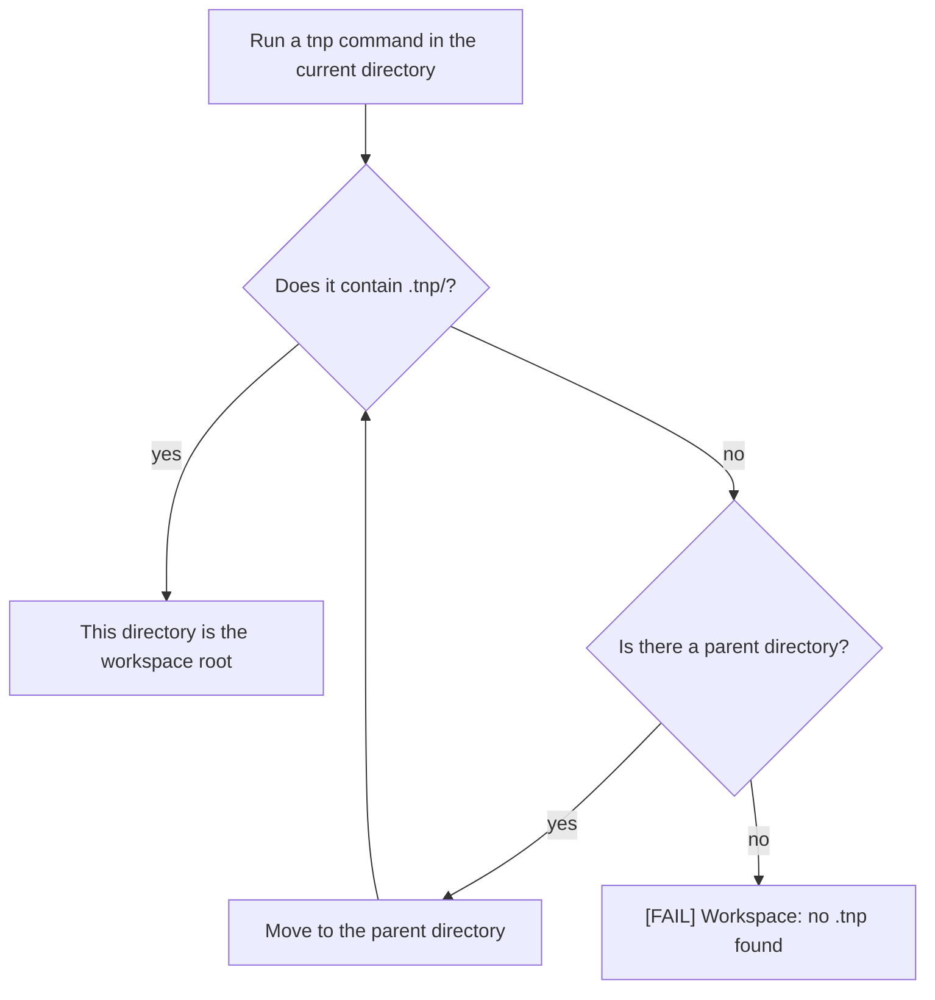
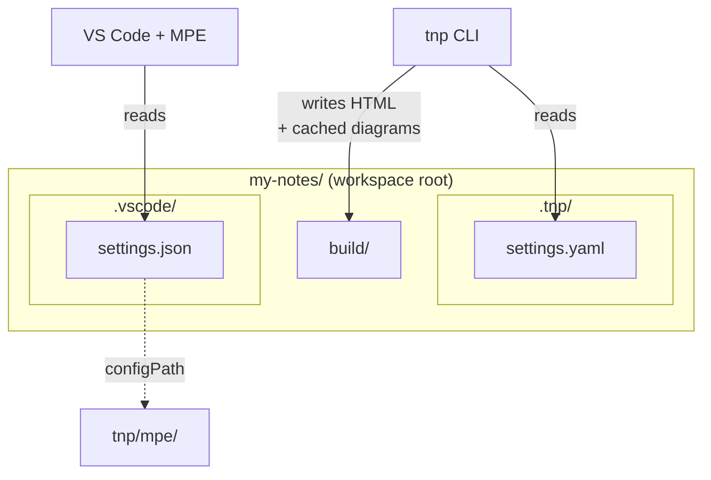

# Setting up a workspace manually

This guide explains how to prepare a directory as a `tnp` workspace **by hand**, without running `tnp init`. It is useful when you want to understand exactly what `init` does, keep the configuration under version control, or script the setup yourself.

## What a workspace is

A `tnp` workspace is simply any directory that contains a `.tnp` folder with a `settings.yaml` file inside it. When you run a `tnp` command, `tnp` looks for that `.tnp` folder in the current directory and, if it does not find one, keeps walking up through the parent directories until it does. The first directory that contains a `.tnp` folder is the **workspace root**.



Relative to that root, `tnp` uses one conventional directory: `build/`, where all generated output (HTML documents and the cached diagram images) is written. It is created automatically on the first build.

So the whole `tnp` configuration is one small file (`.tnp/settings.yaml`); `build/` is a conventional location derived from the root, not something you configure.

`tnp` is more than its command-line tool: it also ships a **Markdown Preview Enhanced (MPE) configuration** (in the project's `mpe/` directory) so the VS Code preview renders the same custom markup as the generated output. The MPE config is part of `tnp` even though the CLI does not use it — the CLI produces the HTML, and the MPE config makes the live preview match that output while you write. You wire it into a notes project through a `.vscode/settings.json` at the workspace root (step 5 below), which also holds the recommended Code Spell Checker settings (step 8, a plain editor convenience). `.vscode/settings.json` is read by VS Code, not by the `tnp` CLI. If you edit the notes in VS Code, configuring MPE (step 5) is required for the preview to match the output; the spell checker (step 8) is optional.

## What `init` does (and what you will do manually)

`tnp init [--pandoc <command>] [--plantuml <plantuml.jar>] [--mermaid <command>]` does the following:

1. Creates a `.tnp` directory in the current directory.
2. Writes `.tnp/settings.yaml` with four keys: `pandoc_bin`, `plantuml_bin`, `mermaid_bin` and `tnp_version`. The three tool paths are optional (any you omit default to the tool being on PATH); `tnp_version` is stamped with the running tnp version.
3. Creates a `.vscode` directory and writes `.vscode/settings.json`, pointing `markdown-preview-enhanced.configPath` at `tnp`'s own `mpe/` directory (the absolute path is filled in for you) and seeding the Code Spell Checker and Nested Tags settings. This is the VS Code configuration described in steps 5–7 below, generated for you.

If a workspace already exists, `init` reinitializes it: it warns, recommends backing up `.tnp`, and asks for confirmation before OVERWRITING the `.tnp` and `.vscode` directories at that workspace root. If there is no `.tnp` but one of the other target paths already exists (for example a stray `.vscode/settings.json`), the create is atomic: it reports the conflict and stops without creating or modifying anything. Set up the workspace by hand (below) if you want to keep such an existing file.

Doing it manually means creating those folders and files yourself, which is what the steps below describe. They are also useful when you want to keep the configuration under version control or understand exactly what `init` writes.

## Steps

### 1. Choose the workspace root

Pick the directory that should be the root of your notes. Everything built from documents under it (or under its subdirectories) will go to `<root>/build/`.

```sh
cd ~/my-notes                    # Windows: cd $env:USERPROFILE\my-notes
```

### 2. Create the `.tnp` directory

```sh
mkdir .tnp
```

### 3. Create `.tnp/settings.yaml`

Create a file `.tnp/settings.yaml` with these keys:

```yaml
pandoc_bin: "pandoc"
plantuml_bin: "java -jar /opt/plantuml/plantuml.jar"
mermaid_bin: "mmdc"
tnp_version: "0.1.1"
```

On Windows the PlantUML line would be, for example, `plantuml_bin: "java -jar C:/ProgramData/plantuml/tools/plantuml.jar"`.

- `pandoc_bin` is the command used to run pandoc. Optional — omit it (or keep `"pandoc"`) to use the `pandoc` on your PATH.
- `plantuml_bin` is the **full command** used to run PlantUML. Note it includes `java -jar` followed by the path to `plantuml.jar`. (When you use `init`, it adds the `java -jar` prefix for you; done by hand, you write the whole command.) A path with spaces goes between single quotes inside the YAML string: `"java -jar 'C:/my tools/plantuml.jar'"` (or escaped double quotes, as `init` writes it). Optional — omit it to default to `java -jar plantuml.jar` (both resolved on PATH).
- `mermaid_bin` is the command used to run the Mermaid CLI. A plain `mmdc` also works on Windows (`tnp` finds `mmdc.cmd` on PATH). Optional — omit it to default to `mmdc` (on PATH).
- `tnp_version` is the tnp version this workspace targets. It is **required** (unlike the tool paths): set it to the version of `tnp` you are using. `check` / `show` compare it with the installed version; a settings file without it is treated as malformed.

> **Use forward slashes `/` in paths, even on Windows.** The value is a double-quoted YAML string, so a Windows path with backslashes (`C:\Tools\plantuml.jar`) would be read as containing escape sequences and fail to parse. Forward slashes work fine for Java and Windows and keep the YAML valid.

Both tools are optional depending on what your documents use:

- **PlantUML** (Java + `plantuml.jar`) is only needed for PlantUML diagrams.
- **Mermaid CLI** (`mmdc`, via Node.js) is only needed for Mermaid diagrams.

If you do not use one of them, you can leave its key out; it only has to be correct when a document actually contains that kind of diagram (`check` reports a missing PlantUML or Mermaid as a warning, not a failure).

### 4. Verify the workspace

From the workspace root (or any subdirectory under it), check that `tnp` recognizes it:

```sh
tnp check
```

`check` walks up to the workspace root and prints one line per check, each prefixed with `[OK ]`, `[WARN]` or `[FAIL]`: the `.tnp` directory and its `settings.yaml`, the tnp-version compatibility, the tool commands (`pandoc_bin`, `plantuml_bin`, `mermaid_bin`), the `.vscode` directory and its `settings.json`, and whether the VS Code MPE `configPath` matches `tnp`'s `mpe/` directory. The workspace is correctly configured when no line is `[FAIL]`. A `[WARN]` does not count as a failure: a minor tnp-version difference, a PlantUML or Mermaid that cannot be found, and any VS Code problem are warnings; a missing pandoc or a malformed `settings.yaml` are failures. A single `[FAIL] Workspace` line means `tnp` did not find a `.tnp` folder in the current directory or any parent — check that `.tnp/settings.yaml` exists and that you are inside the tree.

Show the resolved configuration:

```sh
tnp show
```

This prints the workspace and installed tnp versions and their compatibility, the pandoc, PlantUML and Mermaid commands it will use (with the PATH defaults filled in), the resolved workspace, source and build directories, and the path to `tnp`'s `mpe/` configuration. It does not inspect `.vscode/settings.json`; `check` does.

### 5. Match the VS Code preview to the output (MPE)

The `.tnp/settings.yaml` file is all the `tnp` CLI reads, but the MPE configuration is also part of `tnp`, and when you edit your notes in VS Code this step is required so the live preview renders the same custom markup as the generated HTML (for example the inline `::tnp-todo{...}` tag). Without it, the preview will not match the output.

`tnp` ships the MPE configuration in its own `mpe/` directory (`config.js`, `parser.js`, `style.less`, `head.html`). Point MPE at that folder from your notes workspace with the `markdown-preview-enhanced.configPath` setting. MPE does not expand `${workspaceFolder}`, so the path must be absolute; as a per-project setting, add it to the workspace's `.vscode/settings.json`:

```json
{
  "markdown-preview-enhanced.configPath": "<absolute-path-to>/tnp/mpe"
}
```

Reload the VS Code window (or run "Markdown Preview Enhanced: Refresh Preview") after changing it. The setting lives in `.vscode/settings.json` (read by VS Code, not by the `tnp` CLI), while the config it points to belongs to `tnp`. See [Matching the preview to the output (MPE config)](user-manual.md#matching-the-preview-to-the-output-mpe-config) in the user manual for details.

### 6. Browse notes by tag

`tnp` tags your notes in the YAML front-matter (`tags: [...]`), and the generated HTML shows them as keywords. The [Nested Tags](https://marketplace.visualstudio.com/items?itemName=vscode-nested-tags.vscode-nested-tags) extension (`vscode-nested-tags.vscode-nested-tags`) adds a tree view that lets you browse those tags in the editor.

Because `tnp` keeps tags in the YAML front-matter, point the extension at YAML as an additional file type in the notes workspace's `.vscode/settings.json`:

```json
{
  "vscode-nested-tags.additionalFileTypes": ["md", "yaml"]
}
```

This is an editor convenience, independent of the `tnp` CLI.

### 7. Browse your `::tnp-todo` tags

`tnp` marks pending work inline with the `::tnp-todo` tag. The [Better Todo Tree](https://marketplace.visualstudio.com/items?itemName=FanaticPythoner.better-todo-tree) extension (`FanaticPythoner.better-todo-tree`) collects those tags from your notes and lists them in a tree view in the editor. Install it manually from the Marketplace; it is not installed for you.

Point the extension at the `::tnp-todo` tag in the notes workspace's `.vscode/settings.json`:

```json
{
  "better-todo-tree.general.tags": ["::tnp-todo"],
  "better-todo-tree.regex.regex": "(::tnp-todo)",
  "better-todo-tree.regex.regexCaseSensitive": false,
  "better-todo-tree.highlights.customHighlight": {
    "::tnp-todo": {
      "icon": "check",
      "foreground": "black",
      "background": "yellow",
      "iconColour": "blue"
    }
  }
}
```

- `general.tags` and `regex.regex` make the extension look for the `::tnp-todo` tag instead of the default `TODO` / `FIXME`.
- `highlights.customHighlight` styles the tag in the editor so it stands out while you write.

Like the Nested Tags setting, this is an editor convenience, independent of the `tnp` CLI.

### 8. Configure the spell checker

`tnp` recommends the [Code Spell Checker](https://marketplace.visualstudio.com/items?itemName=streetsidesoftware.code-spell-checker) extension (`streetsidesoftware.code-spell-checker`) for proofreading notes. Technical notes use many product names, acronyms and commands that a plain dictionary flags, so it is worth configuring it per project rather than muting it globally.

Add the configuration to the notes workspace's `.vscode/settings.json`:

```json
{
  "cSpell.language": "en",
  "cSpell.enableFiletypes": ["markdown"],
  "cSpell.words": [
    "tnp",
    "pandoc",
    "plantuml",
    "mermaid",
    "mathjax"
  ]
}
```

- `cSpell.language` sets the dictionary language (use e.g. `"en,es"` to check more than one language at once).
- `cSpell.words` is the per-project list of accepted words. The quickest way to grow it is to use the "Add to workspace settings" quick-fix on a flagged word while editing; that appends it here, so project-specific terms stay with the project instead of your global profile.

Like the MPE setting, this is editor configuration for your notes project and does not go under `.tnp`.

## Resulting layout

After setup, the relevant part of the workspace looks like this:

```text
my-notes/
├── .tnp/
│   └── settings.yaml
├── .vscode/
│   └── settings.json
├── build/
└── ... your .md documents, book.yaml, images, etc.
```

Notes:

- `.tnp/settings.yaml` is the only file the `tnp` CLI reads.
- `.vscode/settings.json` is read by VS Code (not by the `tnp` CLI); it points MPE at `tnp`'s own `mpe/` config via `markdown-preview-enhanced.configPath` (that MPE config is part of `tnp`) and holds the Code Spell Checker settings, from steps 5 and 8.
- `build/` is created automatically the first time you build a report or book; you do not need to create it by hand.
- For building, you can place documents anywhere under the root (including subdirectories); `tnp` finds the workspace by walking up to the `.tnp` folder, and writes output to `<root>/build/` regardless of where the document lives.



## Example `.tnp/settings.yaml`

A complete, minimal example of `settings.yaml` (the tool paths are optional; `tnp_version` is required):

```yaml
pandoc_bin: "pandoc"
plantuml_bin: "java -jar C:/ProgramData/chocolatey/lib/plantuml/tools/plantuml.jar"
mermaid_bin: "mmdc.cmd"
tnp_version: "0.1.1"
```

## Example `.vscode/settings.json`

`tnp` ships a starting point for this file at `tnp_cli/templates/vsc-settings.json.template`. Copy it to `.vscode/settings.json` in your notes workspace and replace the `markdown-preview-enhanced.configPath` value with the absolute path to `tnp`'s own `mpe/` directory (the template leaves it as the `$PathToMpe` placeholder).

A complete example of `.vscode/settings.json` combining the MPE config, the Nested Tags file type, the Better Todo Tree settings and the Code Spell Checker settings:

```json
{
  "markdown-preview-enhanced.configPath": "<absolute-path-to>/tnp/mpe",
  "vscode-nested-tags.additionalFileTypes": ["md", "yaml"],

  "better-todo-tree.general.tags": ["::tnp-todo"],
  "better-todo-tree.regex.regex": "(::tnp-todo)",
  "better-todo-tree.regex.regexCaseSensitive": false,
  "better-todo-tree.highlights.customHighlight": {
    "::tnp-todo": {
      "icon": "check",
      "foreground": "black",
      "background": "yellow",
      "iconColour": "blue"
    }
  },

  "cSpell.language": "en",
  "cSpell.enableFiletypes": ["markdown"],
  "cSpell.words": [
    "tnp",
    "pandoc",
    "plantuml",
    "mermaid",
    "mathjax"
  ]
}
```
