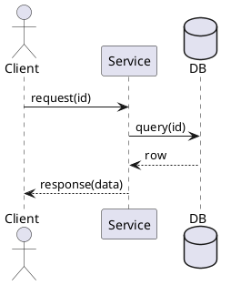
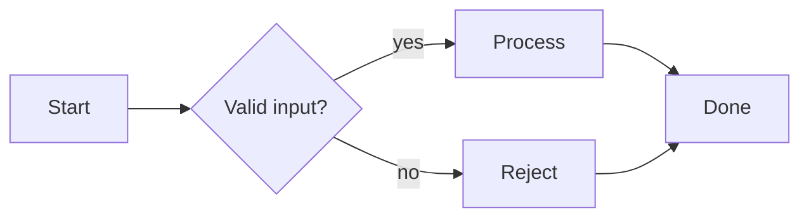

# Figures and diagrams

## Images

Images are regular Markdown images, resolved relative to `book.yaml`:

## PlantUML

A sequence diagram showing a simple request/response between a client and a service, with the service calling a database:

## Mermaid

A flowchart rendered with the Mermaid CLI [@mmdc]:

## Imported diagrams

Diagrams can also live in their own files and be imported with a tag on its own line. A Mermaid diagram from `diagrams/flow.mmd`:

::tnw-mmd{diagrams/flow.mmd}

and a PlantUML diagram from `diagrams/schema.puml`:

::tnw-puml{diagrams/schema.puml}
