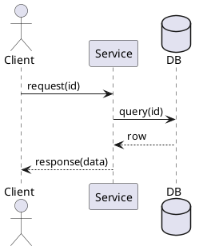
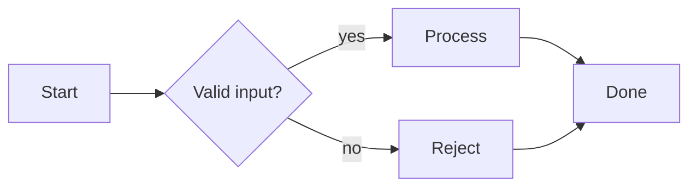

# Example report

## Abstract

This is an example **report** built with `tnp`. Unlike a book, a report is a single Markdown file. Its title is the one top-level `#` heading above (`tnp` does not read a `title` from the YAML front-matter), and the table of contents on the left is built from the `##` sections. The metadata box shows the DID, version, date and keywords from the front-matter.

`tnp` converts the report with pandoc [@pandoc] and adds a few things on top:

- PlantUML and Mermaid diagrams rendered to images (see [Figures and diagrams](#figures-and-diagrams)).
- Mathematics rendered with MathJax (see [Mathematics](#mathematics)).
- The `tnp-todo` tag to highlight pending work (see [Notes and links](#notes-and-links)).
- Citations with return links from the [References](#references).

### How to build it

From anywhere inside a `tnp` workspace:

```sh
tnp build_report html examples/report/example-report.md
```

The result is written to `build/example-report.html` at the workspace root.
::tnp-todo{Add a screenshot of the generated report here.}

## Figures and diagrams

### Images

Images are regular Markdown images, resolved relative to the report:


### PlantUML

A sequence diagram showing a simple request/response between a client and a service, with the service calling a database:



### Mermaid

A flowchart rendered with the Mermaid CLI [@mmdc]:



### Imported diagrams

Diagrams can also live in their own files and be imported with a tag on its own line. A Mermaid diagram from `diagrams/flow.mmd`:

::tnp-mmd{diagrams/flow.mmd}

and a PlantUML diagram from `diagrams/schema.puml`:

::tnp-puml{diagrams/schema.puml}

## Mathematics

Mathematics is written in LaTeX syntax [@knuth1984] and rendered with MathJax, embedded in the HTML so it works offline.

### Entropy

The entropy of a discrete source [@shannon1948] is $H(X) = -\sum_i p_i \log_2 p_i$, measured in bits.

### Channel capacity

The capacity of a channel of bandwidth $B$ with signal-to-noise ratio $S/N$:

$$
C = B \log_2\left(1 + \frac{S}{N}\right)
$$

### A matrix

$$
A = \begin{pmatrix} 1 & 0 \\ 0 & 1 \end{pmatrix}, \qquad \det A = 1
$$

## Notes and links

### The tnp-todo tag

Use the inline form for short remarks ::tnp-todo{check the figures} inside a sentence. Several ::tnp-todo{first} remarks can share a ::tnp-todo{second} line.

The remark may use inline Markdown: ::tnp-todo{review *this* "term", the **bold** text and the `settings.yaml` file}, or point somewhere with a link ::tnp-todo{see the [Links](#links) below}.

Use the block form for longer notes:

::: tnp-todo
This is a block note. It can use **bold**, lists and other Markdown.

- first item
- second item
:::

### Links

Links to sections work within the report: back to the [Abstract](#abstract), or forward to the [Conclusions](#conclusions).

### Grouped citations

Several works can be cited together [@pandoc; @mmdc]. Citing a work again, like pandoc [@pandoc], adds another numbered return link to its entry in the references.

## Conclusions

This report showed the features of `tnp`: the metadata box and the collapsible table of contents in the sidebar, images, diagrams written inline or imported from files, mathematics, the `tnp-todo` tag, links between sections and citations with return links.

Hover a citation such as [@shannon1948] to see the reference in a popup.

## References

---
# Every entry of refs.bib is listed, cited or not.
nocite: |
  @*
---

::: {#refs}
:::
